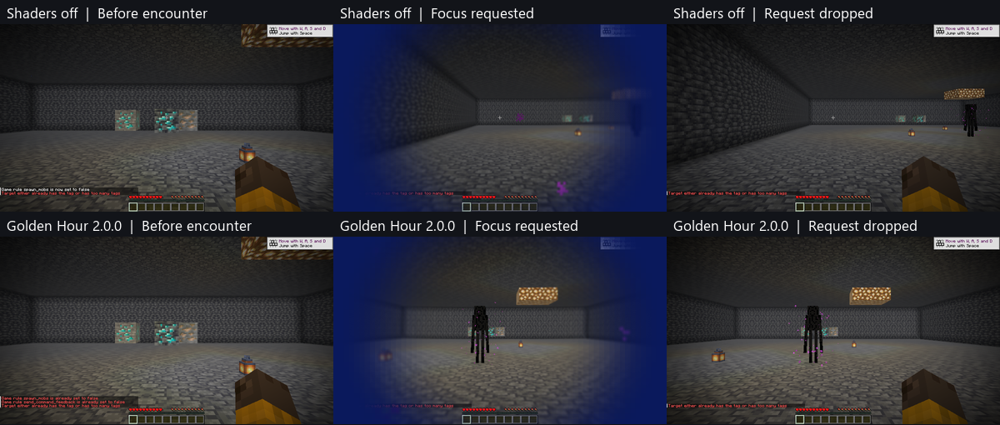
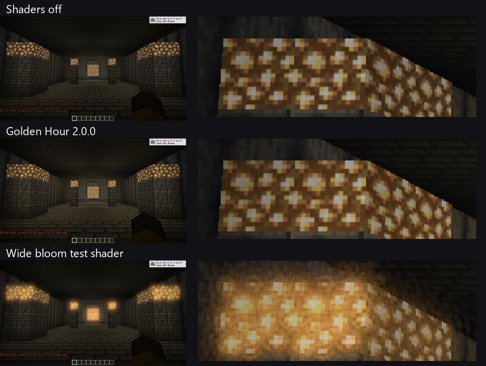

# Horizon singleplayer proof for PR 19747

Ender Undertow Cinematic requested its packaged focus chain through the native hook during two local integrated-server encounters. The client was built from renderer revision 052f5b0 and the Undertow grab fix on 2dd5fa3. The test build logged transitions between returning a request and returning none. The hook parameters, game rendering, and capture output used the usual in-game paths. Both runs used an NVIDIA GTX 1660 SUPER on Vulkan at 800 × 450.

| Shader selection | Before | Request active | Request omitted |
| --- | --- | --- | --- |
| Shaders off | [PNG](off-before.png) | [PNG](off-active.png) | [PNG](off-dropped.png) |
| Golden Hour 2.0.0 | [PNG](golden-before.png) | [PNG](golden-active.png) | [PNG](golden-dropped.png) |

Golden Hour loaded its Warm horizon, Glow, and Colour grade stages. The active screenshots show the recovery after teleport. In both runs, the entire capture interval for the last screenshot falls after the hook began returning no request. Each encounter selected its own destination.

To reproduce with the development client and native mod, enable the encounter data pack, opt in with the cinematic trigger, and use the bundled test encounter with a survival player and an Enderman immediately behind. Capture the destination during recovery and again after recovery. Repeat in the same singleplayer world with Golden Hour selected.

A separate fixed-scene GPU comparison isolates the post effect from camera movement and Undertow's cinematic color overlay. Its white HUD marker stayed white across all three frames. The active effect changed 963 pixels with shaders off and 1,157 with Golden Hour. Omitting the request restored every baseline pixel in both cases. [Capture intervals, hook transitions, and pixel counts](measurements.json)

## Glowstone lighting comparison

The same camera faces a row of glowstone lamps in a singleplayer deepslate chamber. Each row includes the original view and the same detail of the left lamp. Night Vision is off, time is fixed, and the crops use nearest-neighbor enlargement. Golden Hour uses its stock settings. The third row uses a [dedicated wide-bloom shader](glowstone/test-shader) so the warm halo is visible even in a thumbnail.

[Watch Focus clear over the wide-bloom shader](glowstone/lighting-and-focus.gif). For this fixed-camera shot, the test sent the native cinematic's grab and arrival cues in place without moving the player. The lamps keep their bloom when Focus clears. The two encounters above exercise the full teleport. Full-resolution lighting captures: [shaders off](glowstone/off.png), [Golden Hour](glowstone/golden.png), [wide bloom](glowstone/bloom.png).
