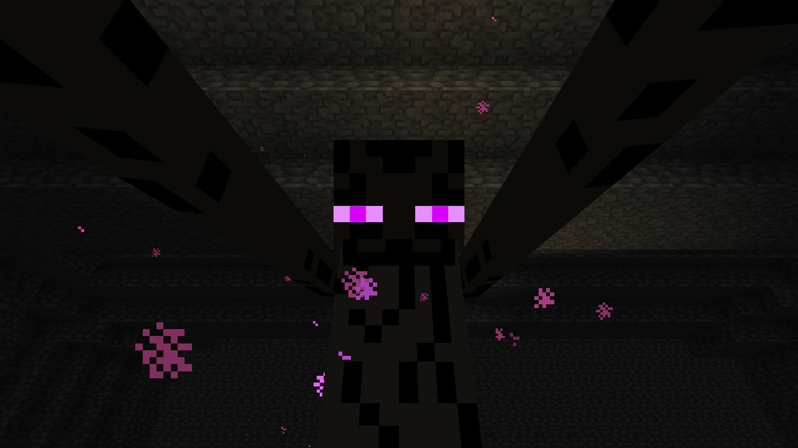

# Ender Undertow gallery

These images show the cinematic mod in Minecraft Java 26.3 on Fabric, beta 10.2. The encounters were staged in game with the HUD hidden. Use the grab as the featured image and the diamond escort last if you want to keep the Gentleman's surprise for the end.

| Gallery title | Caption | Screenshot | Silent loop |
| --- | --- | --- | --- |
| The grab | You turn just in time to meet its eyes. Then the cave disappears. | [JPG](the-grab.jpg) | [GIF](the-grab.gif) |
| The Rift Enderman | Watch for the flicker of soul fire. This one can carry you farther. | [JPG](rift-enderman.jpg) | [GIF](rift-enderman.gif) |
| The Gentleman | A bowler hat and a curled moustache give this rare visitor away. | [JPG](the-gentleman.jpg) | |
| The diamond escort | When the Gentleman finds a suitable exposed vein, you regain your sight facing diamonds. | [JPG](diamond-escort.jpg) | [GIF](diamond-escort.gif) |

The screenshots are 1280 × 720. The looping GIFs are 640 × 360. Each file is under 5 MiB. For the project icon, use the [Ender Undertow logo](../../art/ender_undertow.png).

To hear the Gentleman say “I'm terribly sorry, old chap” and hear the teleport trail off after landing, [watch the encounter with sound](https://github.com/Fnux8890/ender-undertow/releases/download/v0.2.0-beta.10.2/gentleman-encounter.mp4).
